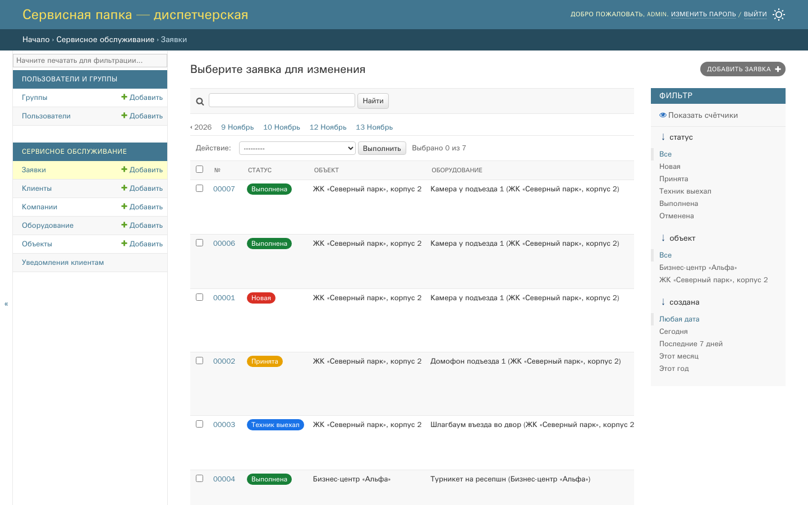
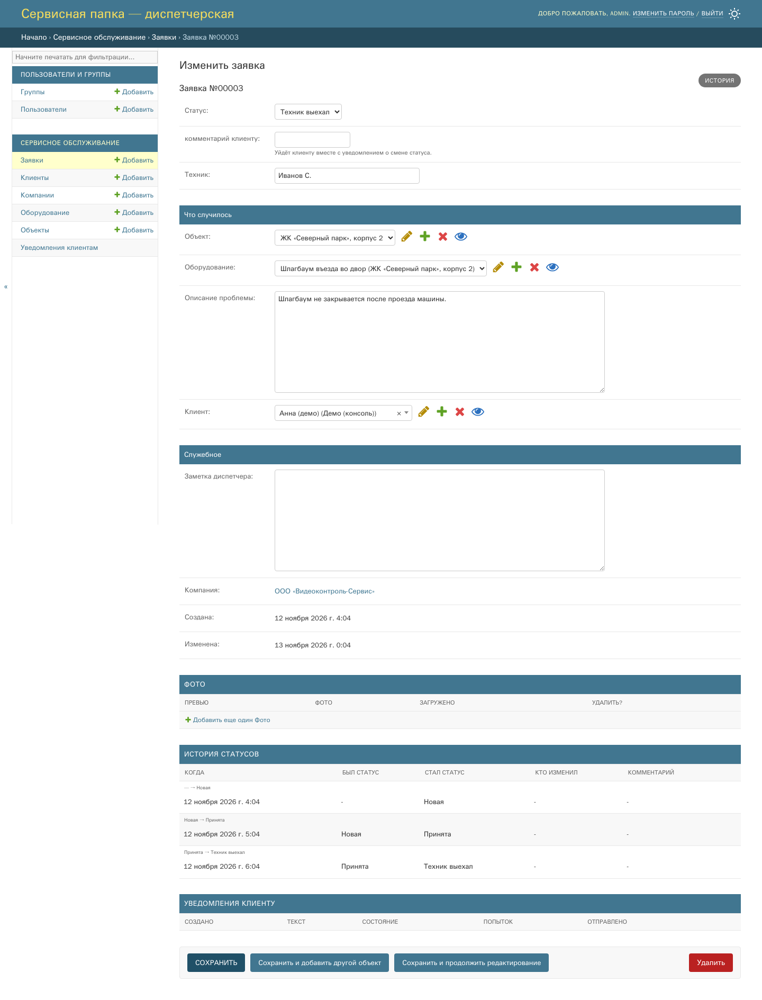

# Боты и интеграции для бизнеса — портфолио

**Для кого:** сервисные и монтажные компании, салоны и мастера, онлайн-школы — всем, у кого заявки и клиенты теряются в личке и таблицах.

Пять рабочих демо на Python. Каждое запускается одной командой `docker compose up`, покрыто тестами и работает без внешних ключей: платёжки, CRM и LLM подменены тестовыми режимами. Для реального запуска токены и ключи прописываются в `.env`, которого нет в репозитории.

| Демо | Что делает | Стек | Тесты |
|---|---|---|---|
| [demo-bot](demo-bot/) | **QR-заявка для сервисной компании.** Клиент сканирует наклейку на оборудовании, бот сам определяет объект и принимает описание с фото. Диспетчеру приходит карточка заявки с кнопками «Принять / Выехал / Выполнено», клиент получает статусы. | Django, PostgreSQL, aiogram 3, MAX Bot API | 85 |
| [demo-ai](demo-ai/) | **ИИ-консультант по базе знаний компании.** Отвечает только по документам, на посторонние вопросы честно отказывает и предлагает оставить заявку. | FastAPI, BM25-поиск, Ollama / YandexGPT / GigaChat | 39 |
| [demo-crm](demo-crm/) | **Заявки с сайта в amoCRM и Битрикс24 без дублей и потерь.** Вебхуки Tilda, GetCourse и generic, очередь с повторами, поиск существующего контакта. | FastAPI, SQLite outbox, httpx | 37 |
| [demo-booking](demo-booking/) | **Бот онлайн-записи.** Услуги, мастера, свободные слоты, защита от двойной записи, напоминания, админка. | aiogram 3, FastAPI, SQLite | 19 |
| [demo-shop](demo-shop/) | **Продажа цифровых товаров с оплатой и автовыдачей.** ЮKassa или Telegram Payments, перепроверка платежа через API, одна выдача при повторных уведомлениях, ссылки с лимитом скачиваний. | aiogram 3, FastAPI, SQLite | 71 |

## Скриншоты

QR-заявка, список заявок в админке диспетчера:

Карточка заявки с историей статусов:

QR-наклейка на оборудование (телефон — заглушка):

## Принципы
- Секреты хранятся только в `.env`, в репозитории лежит `.env.example`.
- Внешние вызовы идемпотентны и повторяются: повторное уведомление не создаёт второй заявки, сделки или выдачи.
- Персональные данные не пишутся в логи.
- Демо-данные вымышлены.

Заказать доработку или похожий проект можно через профиль на фриланс-бирже.
